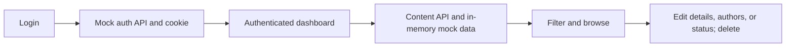

# Editorial Tracker

An editorial workflow demo built with Next.js, React, Tailwind CSS, and TanStack Query.

## Features

- Mock sign-in for Editors and Contributors, with an HTTP-only auth cookie.
- Role-based content visibility: Editors see all items; Contributors see items they author.
- Create content, filter by status, and view details.
- Edit content details and authors, update status, or delete an item.
- Shared authenticated layout with dashboard header.



## Project structure

```text
src/
├── app/                 # Next.js routes, layouts, and API route handlers
│   ├── (authenticated)/ # Shared auth gate and dashboard/content pages
│   ├── api/             # Auth and content endpoints
│   └── login/           # Login page
├── components/          # Shared UI components and query provider
└── features/
		├── auth/            # Mock users, cookie helpers, user context
		├── content/         # Content model, mock data, API helpers, hooks, UI
		└── dashboard/       # Dashboard and shared header
```

## Run locally

Requires Node.js and pnpm.

```sh
pnpm install
pnpm dev
```

Open [http://localhost:3000](http://localhost:3000).
Also available at [https://editorial-tracker-iota.vercel.app/](https://editorial-tracker-iota.vercel.app/).

## Demo login

| Role | Email | Password |
| --- | --- | --- |
| Editor | editor@frihedsbrevet.dk | editor |
| Contributor | contributor@frihedsbrevet.dk | contributor |

## Storage

Content items and mock users are stored in memory; content changes reset when the server process restarts.
